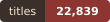
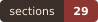
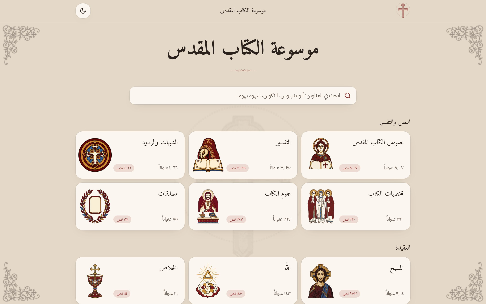
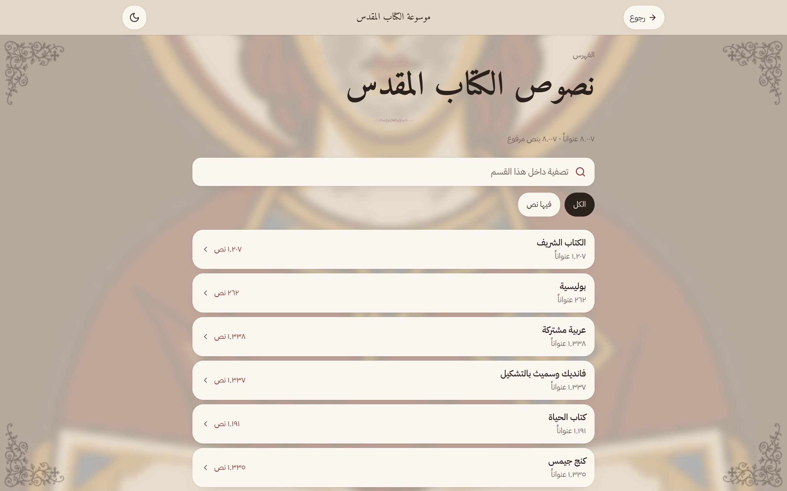
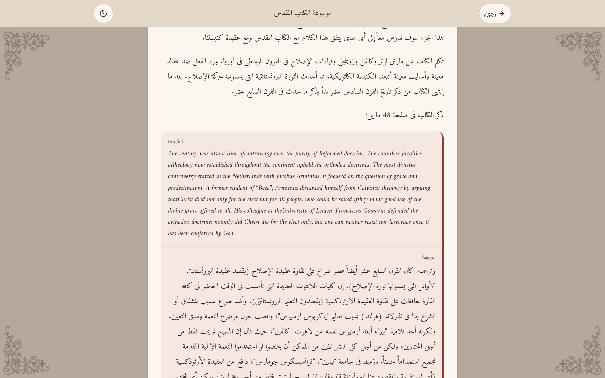
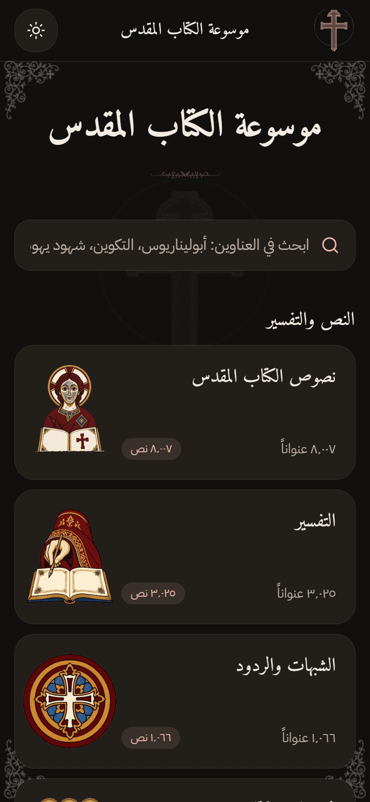
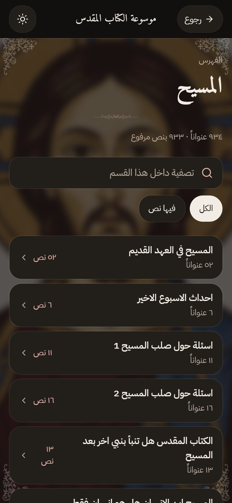
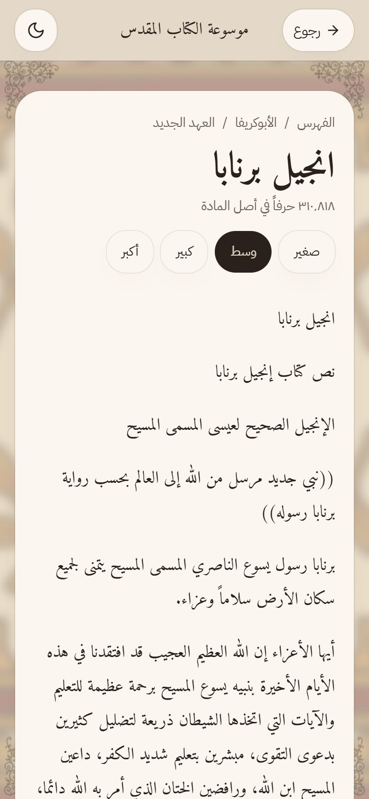

<div align="center">


# موسوعة الكتاب المقدس

### The Arabic Bible Encyclopedia — twenty-two thousand articles, one quiet place to read.

<p>
  <a href="https://bible-encyclopedia.vercel.app/?q="></a>
</p>

<p>
  
  
  
  
  
</p>

<a href="https://bible-encyclopedia.vercel.app/?q=">
  
</a>

</div>

<br />

<div dir="rtl">

**فهرس عربي هادئ لموسوعة الكتاب المقدس.** اكتب عنواناً فيظهر في لحظة، افتح القسم، واقرأ النص كاملاً. العربي في المتن، والإنجليزي يظهر في إطار إلى جانبه حين يرد في الأصل ومعه ترجمته. تسعة وعشرون قسماً، من نص الكتاب وتفسيره إلى العقيدة والكنيسة والتاريخ والحوار، ولكل قسم أيقونته.

</div>

---

## Everything in one place

From the text of Scripture to doctrine, church history, and dialogue — the whole encyclopedia, searchable in an instant and laid out for long, comfortable reading.

<table>
  <tr>
    <td width="50%" valign="top">
      <h3>🔎 Find any title in a keystroke</h3>
      Search all 22,839 titles at once. It forgives Arabic spelling — hamza forms, taa marbuta, alef maqsura, and diacritics all match.
    </td>
    <td width="50%" valign="top">
      <h3>📖 The Bible, in many translations</h3>
      8,007 Bible texts, including Van Dyke, Common Arabic, Book of Life, and more.
    </td>
  </tr>
  <tr>
    <td valign="top">
      <h3>🕊️ 29 illustrated sections</h3>
      Commentary, Bible characters, the Virgin Mary, the Church Fathers, Christology, eschatology, heresies, apologetics, Christianity and Islam, and more — each with its own illustrated icon.
    </td>
    <td valign="top">
      <h3>🌍 English beside Arabic</h3>
      When the source quotes English and gives its translation, the two appear together in a framed box.
    </td>
  </tr>
  <tr>
    <td valign="top">
      <h3>🌙 Made for reading</h3>
      Amiri type, four text sizes, and a day and night theme that carry over between visits.
    </td>
    <td valign="top">
      <h3>⏱️ Pick up where you left off</h3>
      Your recently read articles wait on the home page. Everything stays in your own browser — there's no account to create.
    </td>
  </tr>
  <tr>
    <td valign="top">
      <h3>📱 Phone, tablet, or desktop</h3>
      The same calm layout on every screen. Add it to your home screen and it opens like an app.
    </td>
    <td valign="top">
      <h3>⚡ Light and fast</h3>
      Each article loads on its own, so opening one never downloads the rest.
    </td>
  </tr>
</table>

## A closer look

<table>
  <tr>
    <td width="50%"></td>
    <td width="50%"></td>
  </tr>
  <tr>
    <td align="center"><b>Browse a section</b><br /><sub>Every section opens over its own icon, softly blurred behind the list.</sub></td>
    <td align="center"><b>Read in both languages</b><br /><sub>English quotations sit in a frame, with the Arabic translation right below.</sub></td>
  </tr>
</table>

<table>
  <tr>
    <td align="center"></td>
    <td align="center"></td>
    <td align="center"></td>
  </tr>
  <tr>
    <td align="center"><sub>Night theme</sub></td>
    <td align="center"><sub>Sections on the go</sub></td>
    <td align="center"><sub>Long reads, sized for you</sub></td>
  </tr>
</table>

## By the numbers

<div align="center">

| 22,839 | 22,838 | 29 | 8,007 | 3,025 | 1,328 |
|:---:|:---:|:---:|:---:|:---:|:---:|
| titles | full texts | sections | Bible texts | commentary entries | on Christianity and Islam |

</div>

---

## For developers

<details>
<summary><b>How it's built</b></summary>

<br />

- **Stack:** [TanStack Start](https://tanstack.com/start) with React and Vite, styled with Tailwind CSS, deployed to Vercel through Nitro's `vercel` preset.
- **Routes:** just three — `/` (home and search), `/s/$slug` (a section), and `/r/$slug/$id` (an article).
- **No database.** The encyclopedia ships as static JSON that the browser fetches on demand (`src/lib/encyclopedia.ts`):

  | What | File |
  |---|---|
  | Search index, loaded once | `public/data/search.json` |
  | One section's tree | `public/data/sections/{slug}.json` |
  | One article | `public/data/bodies/{id ÷ 100}/{id}.json` |

  Articles are grouped in folders of 100, so no folder holds more than 100 files.
- **Reading preferences** (theme, text size, recently read) live in `localStorage` (`src/lib/reading.ts`).
- **Images** are stored as base64 text (`*.b64`) and decoded by `scripts/unpack-binary.mjs` at the start of every build.

</details>

<details>
<summary><b>Run it locally</b></summary>

<br />

```sh
npm install
node scripts/unpack-binary.mjs                 # decode the icons and images
node node_modules/vite/bin/vite.js build       # production build into .vercel/output
node node_modules/vite/bin/vite.js preview     # serve it on http://127.0.0.1:8081
```

On macOS and Linux, `npm run dev` and `npm run build` work as usual.

</details>

<details>
<summary><b>Rebuild the encyclopedia data</b></summary>

<br />

The source texts live in `attachments/` (one `.txt` per article, plus `catalog-2.json`). They are kept out of git; only the generated output is committed.

```sh
python scripts/stage-attachments.py     # optional: copy texts from the extracted source apps
python scripts/build-encyclopedia.py    # regenerate public/data and src/data/catalog.ts
```

Don't edit `public/data` or `src/data/catalog.ts` by hand — always regenerate them with the build script.

</details>

<details>
<summary><b>Deploy</b></summary>

<br />

Push to `main`. Vercel builds from the GitHub repository and publishes the site; every pull request gets its own preview.

</details>

---

## License

This repository holds two kinds of material, licensed differently — see [LICENSE](LICENSE).

- **The reader application** — the source code, scripts, configuration, and the artwork in `public/art` — is released under the **MIT License**.
- **The encyclopedia material** — the articles, titles, and catalog (`public/data`, `src/data/catalog.ts`, and the source texts) — belongs to its owner. It is **not** open content and is not covered by the MIT grant.

<div dir="rtl">

للقراءة الشخصية، كما سمح به صاحب المادة. ليست لإعادة النشر التجاري.

</div>
